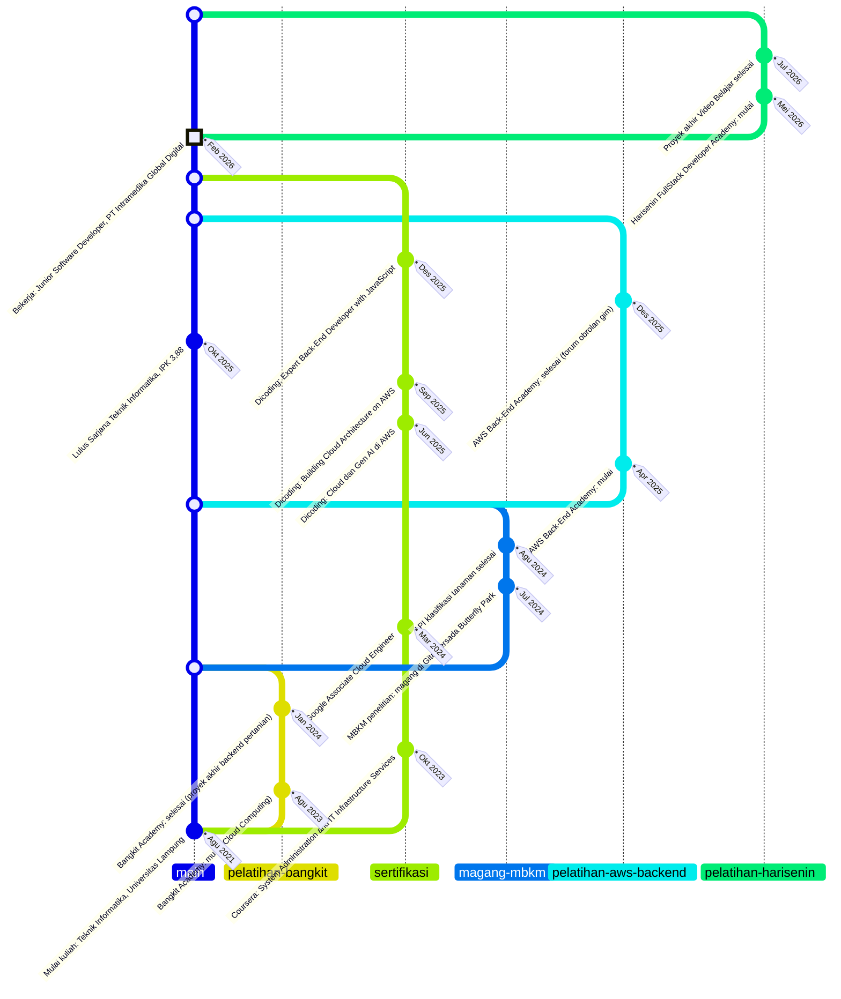

# 04 - Pages

Status: **Approved** (disetujui owner, 2026-10-31)

Spec ini menjabarkan konten dan layout tiap route dari `01-overview.md`. Tampilan visual mengikuti `02-design-system.md`, bahasa mengikuti `03-i18n.md`, dan cerita project mengikuti `06-project-stories.md`. Sumber data konten: CV owner (versi Indonesia dan Inggris) dan situs lama.

## Route

| Path | Halaman |
|---|---|
| `/` | Halaman utama: Hero, Tech stack, Experience, Works, Contact |
| `/projects/:slug` | Detail project |
| `/cv` | Halaman CV (pratinjau, unduh PDF, buka di tab baru) |
| `*` | 404 |

## Layout global

- **Skip link** "Lompat ke konten" sebagai elemen pertama yang bisa difokuskan (tampil saat difokus).
- **Navbar** (menempel di atas, tinggi 64px): logo `alvinreihans` (tautan ke `/`), tautan Pengalaman, Project, Kontak (sesuai urutan section), tautan **CV** (ke `/cv`), tombol tema (ikon), dan tombol bahasa (ikon bendera). Tautan CV di navbar memastikan CV bisa dibuka dari halaman mana pun (G2 di `01-overview.md`).
- **Konten utama** di dalam `<main id="content">`.
- **Footer** dengan section Contact (di halaman utama) atau footer ringkas (di halaman lain).

### Perilaku navbar

- Tautan navbar menuju section di halaman utama (`/#experience`, `/#works`, `/#contact`). Dari `/projects/:slug`, tautan itu membawa pengunjung ke `/` lalu menggulir ke section tujuan.
- Penggulungan ke section halus (`smooth`), kecuali `prefers-reduced-motion` aktif (langsung loncat). Section memakai `scroll-margin-top` agar tidak tertutup navbar.
- **Mobile (di bawah 640px):** tautan disembunyikan dan diganti tombol menu. Menu terbuka sebagai panel di bawah navbar dengan `aria-expanded`, bisa ditutup dengan `Esc`, menutup otomatis setelah memilih tautan, dan fokus kembali ke tombol menu saat ditutup. Tombol tema dan tombol bahasa tetap terlihat di navbar.
- Tidak ada penanda section aktif (scrollspy) pada versi pertama.

### Perilaku antar halaman (SPA)

- Berpindah route memindahkan fokus ke judul utama (`<h1>`) halaman baru dan memperbarui `document.title` (format: `<Halaman> · alvinreihans`).
- Berpindah ke halaman baru dimulai dari atas; tombol kembali browser memulihkan posisi gulir sebelumnya.

## Halaman utama `/`

Urutan section: Hero, Tech stack, Experience, Works, Contact.

### 1. Hero

- Heading Jersey 10 dua baris; baris kedua beraksen (`--accent-display`).
- Paragraf pembuka singkat bersumber dari ringkasan di CV, dengan peran **full-stack developer** (lihat Draf teks). Bagian ringkasan CV yang menyebut hal spesifik tentang pekerjaan di PT Intramedika Global Digital **tidak** dipakai.
- Tombol utama **Lihat CV** (tautan internal ke halaman `/cv`) dan tombol sekunder **Hubungi saya** (`mailto:`).
- Tautan sosial berupa ikon: LinkedIn, GitHub, dan Instagram.
- Dekorasi langit di sisi kanan (matahari/awan di Day, bulan/bintang di Night). Tidak ada foto profil, tidak ada badge, dan tidak ada maskot di hero.

### 2. Tech stack

Lima kelompok, tanpa tingkat kemahiran (tidak ada bar atau persentase). Isinya mengikuti daftar "Technical skills" di CV:

| Kelompok | Isi |
|---|---|
| Bahasa & Frontend | JavaScript, TypeScript, React, Next.js, Tailwind CSS |
| Backend | Node.js, Express.js, Hapi, REST API, JWT Auth, RBAC, Clean Architecture, TDD, MQTT |
| Database & Storage | PostgreSQL, MySQL, Oracle Database, Redis, Supabase, MinIO |
| AI & OCR | OCR Tesseract, Integrasi LLM |
| Cloud & DevOps | AWS (EC2, RDS, S3, IAM), Google Cloud (Compute Engine, Cloud SQL), Vercel, GitHub Actions (CI/CD), Docker, Linux (Ubuntu), PM2, Nginx, Git |

Nama teknologi tidak diterjemahkan. Data disimpan sebagai konstanta di kode (`src/content/stack`), bukan di berkas terjemahan. Daftar ini mengikuti CV apa adanya (Flask dan Python tidak masuk karena tidak ada di CV).

### 3. Experience (roadmap bergaya graph GitHub)

Section ini menampilkan perjalanan kuliah, kerja, dan belajar sebagai **graph commit vertikal**, seperti graph riwayat di GitHub atau VS Code: satu jalur utama dengan cabang-cabang yang bercabang lalu menyatu kembali.

**Aturan jalur**
- Jalur **utama** (`main`) berisi perjalanan inti: **Kuliah** dan **Pekerjaan**.
- Jalur **cabang** berisi hal yang berjalan di samping jalur utama: **Magang (MBKM)**, **Pelatihan**, dan **Sertifikasi**. Cabang dimulai dari jalur utama saat kegiatannya dimulai dan menyatu kembali (merge) saat selesai. Cabang yang masih berjalan tidak punya penyatuan.
- Urutan dari terbaru di atas ke terlama di bawah, seperti `git log`. Posisi mengikuti urutan kejadian, bukan skala waktu.

**Rencana graph** (diagram Mermaid sebagai rencana saja; situs memakai SVG buatan sendiri yang mengikuti tema dan bahasa, bukan Mermaid, sejalan dengan keputusan diagram di `06-project-stories.md`). Pada Mermaid ini kejadian tertua ada di bawah dan terbaru di atas (`BT`):



Pada rencana ini, paling banyak **tiga jalur** berjalan bersamaan (utama + dua cabang), pada Okt 2023 sampai Jan 2024 dan Apr 2025 sampai Des 2025.

**Tampilan di situs**
- Setiap kejadian adalah satu "commit": simpul persegi pixel di jalurnya, dengan kartu di sampingnya berisi organisasi, judul kejadian, bulan dan tahun, dan (jika ada) satu kalimat ringkasan.
- Simpul penyatuan (merge) berupa simpul kecil berongga di jalur utama, tanpa kartu.
- Kejadian terbaru yang masih berjalan (pekerjaan saat ini) diberi penanda "HEAD" dengan teks "Sekarang" / "Present", mirip penanda di graph acuan.
- Setiap cabang punya label berbentuk chip di dekat awal cabangnya, mirip label branch di GitHub: ID `pelatihan/bangkit`, EN `training/bangkit` (teks label ada di data tiap bahasa).
- Warna tidak ditambah (tetap satu aksen). Jalur utama memakai `--accent` bergaris solid. Cabang memakai warna netral (`--muted` dan `--ink`) dengan pola garis dan bentuk simpul yang berbeda per jenis (Pelatihan putus-putus, Magang titik-titik, Sertifikasi garis tipis dengan simpul kecil). Pembeda utamanya tetap label teks.
- Legenda singkat di atas graph: Kuliah dan Pekerjaan (utama), Magang, Pelatihan, Sertifikasi.
- Garis dan simpul adalah SVG dekoratif (`aria-hidden`), bergaya pixel (`crispEdges`).

**Aksesibilitas dan responsif**
- Strukturnya daftar berurutan (`<ol>`) berisi kejadian saja; tiap item membawa label teks jenisnya ("Kuliah", "Pekerjaan", "Magang", "Pelatihan", "Sertifikasi") dan tanggal dalam elemen `<time>`.
- Di mobile, graph menyempit menjadi gutter di sisi kiri selebar jumlah jalur aktif (maksimal tiga) dan kartu memenuhi sisa lebar.
- Tidak ada animasi garis; jika nanti ditambahkan, berhenti saat `prefers-reduced-motion` aktif.

**Algoritma penempatan jalur** (agar data baru tidak perlu mengatur posisi manual):
1. Urutkan kejadian dari terbaru ke terlama.
2. Jalur 0 selalu jalur utama.
3. Setiap cabang menempati jalur bebas terkecil di sebelah kanan jalur utama selama ia berjalan (dari kejadian "mulai" sampai "selesai/merge"), dan jalur itu dipakai ulang setelah cabang menyatu.
4. Kartu selalu ditempatkan di sebelah kanan jalur paling kanan yang aktif pada barisnya.

**Data** disimpan di `src/content/experience.json`:

```json
{
  "branches": [
    { "id": "bangkit", "kind": "training",
      "label": { "id": "pelatihan/bangkit", "en": "training/bangkit" } }
  ],
  "events": [
    { "date": "2023-08", "branch": "bangkit", "type": "training",
      "org": "Bangkit Academy",
      "title": { "id": "Mulai: Siswa Cloud Computing", "en": "Start: Cloud Computing Student" },
      "summary": { "id": "…", "en": "…" } }
  ]
}
```

- `branch` bernilai `main` atau id cabang. `type` bernilai `education`, `work`, `internship`, `training`, atau `certification`.
- Cabang menyatu pada kejadian terakhirnya, kecuali diberi `ongoing: true`. Tanggal ditulis `YYYY-MM` dan ditampilkan dengan format bulan-tahun (lihat `03-i18n.md`). `summary` boleh dikosongkan.

**Daftar kejadian** (dari CV dan keputusan owner; terbaru dulu):

| Tanggal | Jalur | Jenis | Judul (Indonesia) |
|---|---|---|---|
| Mei 2026 sampai Jul 2026 | `pelatihan/harisenin` | Pelatihan | Harisenin FullStack Developer Academy (mulai, lalu proyek akhir Video Belajar) |
| Feb 2026 | main | Pekerjaan | Junior Software Developer, PT Intramedika Global Digital (sekarang) |
| Des 2025 | `sertifikasi` | Sertifikasi | Dicoding: Expert Back-End Developer with JavaScript |
| Des 2025 | `pelatihan/aws-backend` | Pelatihan | AWS Back-End Academy (selesai) |
| Okt 2025 | main | Kuliah | Lulus Sarjana Teknik Informatika, Universitas Lampung (IPK 3,88) |
| Sep 2025 | `sertifikasi` | Sertifikasi | Dicoding: Building Cloud Architecture on AWS |
| Jun 2025 | `sertifikasi` | Sertifikasi | Dicoding: Learning the Basics of Cloud and Gen AI on AWS |
| Apr 2025 | `pelatihan/aws-backend` | Pelatihan | AWS Back-End Academy (mulai) |
| Jul 2024 sampai Agu 2024 | `magang-mbkm` | Magang | MBKM penelitian: magang di Gita Persada Butterfly Park |
| Mar 2024 | `sertifikasi` | Sertifikasi | Google Associate Cloud Engineer (berlaku sampai Mar 2027) |
| Jan 2024 | `pelatihan/bangkit` | Pelatihan | Bangkit Academy (selesai, proyek akhir backend pertanian) |
| Okt 2023 | `sertifikasi` | Sertifikasi | Coursera: System Administration and IT Infrastructure Services |
| Agu 2023 | `pelatihan/bangkit` | Pelatihan | Bangkit Academy (mulai, Cloud Computing) |
| Agu 2021 | main | Kuliah | Mulai kuliah Teknik Informatika, Universitas Lampung |

Catatan:
- **PT Intramedika Global Digital:** kartu hanya menampilkan organisasi, peran, dan periode, tanpa ringkasan. Owner menyatakan belum ada hal dari pekerjaan ini yang bisa dipublikasikan.
- **MBKM penelitian** adalah magang di Gita Persada Butterfly Park (keputusan owner), sehingga satu kejadian di cabang `magang-mbkm`, bukan dua entri terpisah.
- **Sertifikasi** tidak punya ringkasan; judulnya sudah cukup.

**Ringkasan kejadian** (dari CV tulisan owner; ditandai `_review` sampai ditinjau):

| Kejadian | Indonesia | Inggris |
|---|---|---|
| Kuliah (lulus) | Sarjana Teknik Informatika, IPK 3,88/4,00. Skripsi: Pengembangan Backend Aplikasi Pemantauan Smart Stick IoT Real-time Berbasis MQTT dan Node.js. | Bachelor of Engineering in Informatics Engineering, GPA 3.88/4.00. Thesis: Backend Development for a Real-time IoT Smart Stick Monitoring Application Based on MQTT and Node.js. |
| Bangkit Academy (selesai) | Proyek akhir: layanan backend untuk aplikasi Android pertanian yang terintegrasi dengan model machine learning, di-deploy di Google Cloud (Compute Engine dan Cloud SQL). | Final project: a backend service for an agriculture Android application integrated with machine learning models, deployed on Google Cloud using Compute Engine and Cloud SQL. |
| Magang MBKM (Gita Persada Butterfly Park) | Mengembangkan RESTful API berbasis Flask untuk aplikasi klasifikasi tanaman yang terintegrasi dengan model machine learning, di-deploy di Google Compute Engine dengan Cloud SQL dan Cloud Storage. | Developed a Flask-based RESTful API for a plant classification application integrated with a machine learning model, deployed on Google Compute Engine with Cloud SQL and Cloud Storage. |
| AWS Back-End Academy (selesai) | Membangun layanan backend forum obrolan gim dengan clean architecture dan TDD, pipeline CI/CD GitHub Actions, serta deployment ke Amazon EC2 dan Amazon RDS. | Built a backend service for a gaming chat forum using clean architecture and TDD, a GitHub Actions CI/CD pipeline, and deployment to Amazon EC2 and Amazon RDS. |
| Harisenin (proyek akhir) | Proyek akhir Video Belajar: platform kursus online berbentuk monorepo dengan SPA React (Vite, Tailwind CSS, Redux) dan REST API Express.js dengan MySQL. | Final project Video Belajar: an online course platform structured as a monorepo, with a React SPA (Vite, Tailwind CSS, Redux) and an Express.js and MySQL REST API. |

### 4. Works

- **Project hero (Money Tracker):** kartu besar di bagian atas section: judul, ringkasan, diagram arsitektur (komponen `flow`, lihat `06-project-stories.md`), tag, dan tautan. Karena tombol utama sudah dipakai di hero, tautan di sini berbentuk **tautan teks**: "Baca ceritanya" (ke `/projects/money-tracker`), "Lihat demo", dan "Lihat repo".
- **Kartu project lain:** grid (1 kolom di bawah 640px, 2 kolom di atasnya) untuk project sisanya. Setiap kartu menampilkan judul, ringkasan, dan tag.
- Isi dan urutan dibuat dari `meta.json` tiap project (urutan mengikuti `order`).
- **Satu tautan utama per kartu:** judul menuju `/projects/:slug`, dengan area klik yang menutupi seluruh kartu. Tautan repo dan demo adalah tautan terpisah di atasnya (tidak ada tautan di dalam tautan).
- Tautan eksternal dibuka di tab baru dengan `rel="noopener noreferrer"` dan diberi penanda ikon serta nama aksesibel yang menyebutkan bahwa tautan itu eksternal.

### 5. Contact

- Heading Jersey 10 dan satu kalimat yang menyatakan Alvin terbuka untuk peluang baru (G8 di `01-overview.md`), tanpa badge.
- Tombol **Kirim email** (`mailto:` dengan subjek sesuai bahasa) dan tombol **Salin email** (menyalin alamat; setelah berhasil teksnya berubah sebentar menjadi "Email disalin" dan diumumkan lewat `aria-live="polite"`).
- Tautan sosial (sama seperti di hero): LinkedIn, GitHub, Instagram.
- Maskot berang-berang (sekitar 80px) duduk di tepi atas footer pada Day atau tidur telentang mengapung pada Night.
- Tidak ada form. Nomor telepon tidak ditampilkan di situs.

### Footer

Satu baris: `© <tahun> alvinreihans` (tahun dihitung otomatis dari tanggal saat ini). Tidak ada tautan lain.

## Detail project `/projects/:slug`

Urutan dari atas ke bawah:

1. Tautan kembali "Semua project" ke `/#works`.
2. **Kotak fakta:** judul (`<h1>`, Jersey 10), ringkasan, tag, tautan repo dan demo (dari `meta.json`).
3. **Pemberitahuan bahasa** (hanya jika perlu): jika `en.md` belum ada saat bahasa Inggris dipilih, tampil di atas cerita: "This story isn't available in English yet. Showing the Indonesian version."
4. **Cerita** (markdown): satu kolom dengan lebar baca maksimal sekitar 70 karakter. Gambar mengikuti lebar kolom, diagram `flow` dirender di tempatnya.
5. **Project berikutnya:** tautan ke project berikutnya menurut `order` (project terakhir kembali ke yang pertama).
6. Footer ringkas.

Slug yang tidak ada menampilkan halaman 404 yang sama.

## Halaman CV `/cv`

Referensi tampilan: `mockups/d-cv-page.html` (lokal). Urutan dari atas ke bawah:

1. Tautan kembali "Kembali ke beranda" ke `/`.
2. Badge kecil "Selalu versi terbaru".
3. Judul (`<h1>`, Jersey 10): "CV" beraksen diikuti nama.
4. Satu kalimat: pratinjau diambil langsung dari dokumen CV, jadi selalu versi terbaru.
5. Tombol utama **Unduh PDF** (tautan ekspor) dan tombol sekunder **Buka di tab baru** (tautan pratinjau). Keduanya ke dokumen sesuai bahasa aktif, membuka tab baru. Di bawah 640px kedua tombol selebar layar.
6. **Bingkai pratinjau:** kartu berisi `<iframe>` ke tautan pratinjau Google Docs (lihat `03-i18n.md`), tinggi sekitar 80% layar (70% di mobile), dengan `title` deskriptif sesuai bahasa, `loading="lazy"`, dan teks "Memuat pratinjau…" sampai iframe selesai dimuat.
7. Petunjuk kecil: jika pratinjau terlalu kecil di HP, gunakan "Buka di tab baru" atau unduh PDF.
8. Footer ringkas.

Perilaku dan batasan:
- Isi bingkai adalah tampilan pratinjau milik Google (latar dan kontrol kecil Google), tidak mengikuti tema Day/Night. Yang mengikuti tema adalah halaman di sekelilingnya.
- Jika iframe gagal dimuat (misalnya pengaturan berbagi dokumen berubah), tombol Unduh PDF dan Buka di tab baru tetap tersedia sebagai jalan keluar.
- `document.title`: "CV · alvinreihans".
- `alvinreihans.web.id/cv` adalah tautan pendek resmi untuk CV (misalnya di email lamaran dan profil LinkedIn).

## 404

- Maskot berang-berang besar (sekitar 192px) dengan pose sesuai tema.
- Heading "404" (Jersey 10), pesan singkat, dan tombol utama **Kembali ke beranda**.
- Muncul untuk path yang tidak dikenal dan slug project yang tidak ada, di dalam layout global (navbar dan footer tetap tampil).

## Responsif

Mobile first. Titik patah: 640px, 768px, 1024px. Lebar konten maksimum 1200px dengan gutter minimal 24px. Semua halaman diuji di 320px, 390px, 768px, dan 1280px, pada kedua bahasa dan kedua tema.

## CV publik

CV yang bisa diunduh dari situs adalah dokumen Google Docs yang dapat dibuka siapa saja yang punya tautannya, jadi isinya harus aman dipublikasikan:

- **Tanpa nomor telepon** (keputusan owner). Kontak di CV memakai email, LinkedIn, dan alamat situs.
- **Rincian pekerjaan di PT Intramedika Global Digital diringkas** (keputusan owner): tanpa angka spesifik (jumlah kode izin, endpoint, atau berkas), tanpa nama sistem atau lembaga eksternal yang terhubung, dan tanpa nama produk internal.
- Ringkasan profil di CV disamakan dengan teks hero: tidak menyebut klaim BPJS atau sistem pemerintah.
- CV kerja owner yang sekarang (berisi nomor telepon dan rincian pekerjaan) **belum memenuhi aturan di atas**, jadi tidak boleh dipakai sebagai CV publik. Owner membuat **salinan khusus publik** (Indonesia dan Inggris) di Google Docs, menerapkan aturan di atas pada salinan itu, dan hanya salinan itu yang ditautkan dari situs.

### CV lewat Google Docs (keputusan Q5.2)

- Halaman `/cv` menampilkan pratinjau dokumen publik di iframe dan menyediakan tautan ekspor PDF (lihat `03-i18n.md`), sehingga setiap pembaruan di dokumen otomatis ikut terbaru tanpa deploy ulang. Penanaman pratinjau di iframe sudah diuji bekerja dengan dokumen owner pada 2026-10-31.
- Pengaturan dokumen: berbagi "Siapa saja yang memiliki tautan: Pelihat", dengan unduh, cetak, dan salin diizinkan (kalau tidak, tautan ekspor tidak berfungsi untuk pengunjung).
- Karena dokumen bisa dilihat langsung, **setiap suntingan langsung terlihat publik**, termasuk suntingan yang belum selesai. Suntingan pada salinan publik dilakukan dengan hati-hati; CV kerja yang berisi data pribadi tidak pernah dijadikan publik.
- Judul dokumen menjadi nama berkas yang terunduh, jadi diberi nama yang rapi, misalnya "CV - Alvin Reihansyah Makarim (Indonesia)" dan "CV - Alvin Reihansyah Makarim (English)".
- Aturan di atas tidak bisa dipaksakan saat build, jadi dijaga lewat pemeriksaan: skrip kecil mengambil kedua tautan ekspor, mengekstrak teksnya, dan memeriksa pola nomor telepon serta kata kunci terlarang. Dijalankan sebelum cutover dan atas permintaan owner setelahnya.

Usulan ringkasan bullet untuk bagian PT Intramedika Global Digital (dipakai di kedua versi CV):

| Indonesia | Inggris |
|---|---|
| Mengembangkan fitur backend dan integrasi dengan sistem eksternal pada aplikasi SaaS multi-tenant untuk pengelolaan klaim di lingkungan rumah sakit. | Developed backend features and integrations with external systems for a multi-tenant SaaS application for claims management in hospitals. |
| Merancang ulang kontrol akses menjadi berbasis izin dan menegakkannya secara terpusat di seluruh endpoint API. | Redesigned access control into a permission-based model and enforced it centrally across all API endpoints. |
| Membangun pipeline pemrosesan dokumen berbasis OCR dan LLM. | Built a document processing pipeline based on OCR and LLMs. |
| Menyiapkan CI/CD GitHub Actions, migrasi skema basis data, dan test suite berlapis. | Set up GitHub Actions CI/CD, database schema migrations, and a layered test suite. |

Usulan kalimat ringkasan profil di CV (Indonesia): "Sarjana Teknik Informatika Universitas Lampung yang kini bekerja sebagai full-stack developer, membangun aplikasi SaaS multi-tenant untuk pengelolaan klaim di lingkungan rumah sakit, mencakup kontrol akses berbasis izin dan pemrosesan dokumen berbasis OCR & LLM. Tertarik pada perancangan sistem backend yang andal, teruji, dan mudah diaudit." Versi Inggrisnya mengikuti.

Kata kunci terlarang yang diperiksa: `E-Klaim`, `INA-CBG`, `iDRG`, `SIMRS`, `BPJS`, ditambah pola nomor telepon.

## Metadata, favicon, dan gambar Open Graph

Metadata statis di `index.html`, dalam **bahasa Inggris** (keputusan Q3.7 di `03-i18n.md`), karena pratinjau tautan dan mesin pencari tidak menjalankan pemilihan bahasa:

- `<title>`, `<meta name="description">`, `<link rel="canonical" href="https://alvinreihans.web.id/">`.
- Open Graph: `og:type` (`website`), `og:title`, `og:description`, `og:url`, `og:image`, `og:image:alt`, `og:locale` (`en_US`) dan `og:locale:alternate` (`id_ID`).
- `<html lang="en">` sebagai nilai awal; skrip penentu bahasa menggantinya sebelum render pertama.
- Usulan teks (ditinjau owner): judul "Alvin Reihansyah Makarim · Full-Stack Developer"; deskripsi "Full-stack developer focused on reliable backend systems. Works with Node.js, React, and PostgreSQL, with production deployment experience on AWS and Google Cloud." Kartu Twitter/X: `twitter:card` = `summary_large_image`.

**Gambar Open Graph** (dibuat sebagai bagian dari pekerjaan ini):
- Berkas `public/og-image.png`, ukuran 1200x630, berat di bawah 300 KB.
- Isi: nama, peran (Full-Stack Developer), domain `alvinreihans.web.id`, maskot berang-berang, serta matahari dan awan pixel, dengan palet Day dan font Jersey 10 dan Manrope.
- Dihasilkan dari templat HTML sekali jalan (tangkapan layar), lalu berkasnya yang disimpan. Pembuatan menunggu sprite berang-berang disetujui (lihat `02-design-system.md`).
- Catatan: pratinjau tautan di LinkedIn dan platform lain menyimpan cache; perubahan gambar bisa baru terlihat setelah cache diperbarui.

**Favicon:** kepala berang-berang pixel, dalam `public/favicon.svg` ditambah `favicon-32.png` dan `apple-touch-icon.png` (180x180).

`robots.txt` dan `sitemap.xml` (berisi `/` dan URL project) dibahas di `05-deployment.md`.

## Draf teks (perlu ditinjau owner)

Teks Indonesia adalah sumber. Semua entri di bawah ditandai `_review` sampai owner menyetujuinya (aturan 11 di `CLAUDE.md`). Hero lead bersumber dari ringkasan di CV owner, **tanpa** bagian yang menyebut pekerjaan di PT Intramedika Global Digital.

| Kunci | Indonesia | Inggris |
|---|---|---|
| `common:nav.experience` | Pengalaman | Experience |
| `common:nav.projects` | Project | Projects |
| `common:nav.contact` | Kontak | Contact |
| `common:nav.cv` | CV | CV |
| `common:skipToContent` | Lompat ke konten | Skip to content |
| `common:externalLink` | (tautan eksternal) | (external link) |
| `home:hero.titleLine1` | Membangun sistem backend | Building backend systems |
| `home:hero.titleLine2` | yang andal. | that stay reliable. |
| `home:hero.lead` | Saya Alvin, full-stack developer lulusan Teknik Informatika Universitas Lampung. Saya tertarik pada perancangan sistem backend yang andal, teruji, dan mudah diaudit, dengan Node.js, TypeScript, React, Express.js, dan PostgreSQL, serta pengalaman men-deploy ke produksi di AWS dan Google Cloud melalui CI/CD terotomatisasi. | I'm Alvin, a full-stack developer with a degree in Informatics Engineering from the University of Lampung. I'm interested in designing backend systems that are reliable, well-tested, and auditable, working with Node.js, TypeScript, React, Express.js, and PostgreSQL, and I have deployed to production on AWS and Google Cloud through automated CI/CD. |
| `home:hero.cv` | Lihat CV | View CV |
| `home:hero.contact` | Hubungi saya | Contact me |
| `home:experience.heading` | Pengalaman | Experience |
| `home:experience.type.education` | Kuliah | Education |
| `home:experience.type.work` | Pekerjaan | Work |
| `home:experience.type.internship` | Magang | Internship |
| `home:experience.type.training` | Pelatihan | Training |
| `home:experience.type.certification` | Sertifikasi | Certification |
| `home:experience.present` | Sekarang | Present |
| `home:works.heading` | Project | Projects |
| `home:contact.heading` | Mari berdiskusi. | Let's talk. |
| `home:contact.body` | Saya terbuka untuk peluang baru. Untuk pekerjaan, kolaborasi, atau sekadar menyapa, silakan kirim email. | I'm open to new opportunities. For a job, a collaboration, or just to say hello, feel free to send an email. |
| `home:contact.email` | Kirim email | Send email |
| `home:contact.copy` | Salin email | Copy email |
| `home:contact.copied` | Email disalin | Email copied |
| `project:back` | Semua project | All projects |
| `project:next` | Project berikutnya | Next project |
| `project:readStory` | Baca ceritanya | Read the story |
| `project:viewDemo` | Lihat demo | View demo |
| `project:viewRepo` | Lihat repo | View repo |
| `project:noEnglish` | (tidak dipakai) | This story isn't available in English yet. Showing the Indonesian version. |
| `cv:back` | Kembali ke beranda | Back to home |
| `cv:badge` | Selalu versi terbaru | Always up to date |
| `cv:intro` | Full-stack developer. Pratinjau di bawah diambil langsung dari dokumen CV saya, jadi selalu versi terbaru. | Full-stack developer. The preview below comes straight from my CV document, so it is always the latest version. |
| `cv:download` | Unduh PDF | Download PDF |
| `cv:openNewTab` | Buka di tab baru | Open in new tab |
| `cv:loading` | Memuat pratinjau… | Loading preview… |
| `cv:hint` | Pratinjau terlalu kecil di HP? Gunakan "Buka di tab baru" atau unduh PDF-nya. | Preview too small on your phone? Use "Open in new tab" or download the PDF. |
| `cv:frameTitle` | Pratinjau CV Alvin Reihansyah Makarim (bahasa Indonesia) | CV preview of Alvin Reihansyah Makarim (English) |
| `notFound:title` | Halaman tidak ditemukan | Page not found |
| `notFound:body` | Halaman yang Anda cari tidak ada atau sudah dipindahkan. | The page you're looking for doesn't exist or has moved. |
| `notFound:home` | Kembali ke beranda | Back to home |

Catatan: `project:noEnglish` hanya muncul saat bahasa Inggris dipilih dan `en.md` belum ada, jadi teks Indonesianya tidak dipakai. Kunci ini dikecualikan dari aturan keseimbangan kunci di `check-i18n`.

## Kriteria penerimaan

- [ ] AC1. Halaman utama menampilkan section Hero, Tech stack, Experience, Works, dan Contact sesuai urutan, pada kedua bahasa dan kedua tema.
- [ ] AC2. Tautan navbar menggulir ke section yang benar tanpa tertutup navbar, termasuk ketika diklik dari halaman detail project.
- [ ] AC3. Di bawah 640px, tautan navbar diganti tombol menu yang bisa dioperasikan keyboard (`Enter`, `Spasi`, `Esc`), memakai `aria-expanded`, dan mengembalikan fokus saat ditutup.
- [ ] AC4. Skip link berfungsi dan tampil saat difokus.
- [ ] AC5. Berpindah route memindahkan fokus ke `<h1>` dan memperbarui `document.title`.
- [ ] AC6. Section Works menampilkan semua project dari `meta.json`: Money Tracker sebagai kartu besar, sisanya sebagai kartu biasa, urut sesuai `order`.
- [ ] AC7. Setiap kartu hanya punya satu tautan utama ke halaman detail; tidak ada tautan bersarang; tautan eksternal membuka tab baru dengan `rel="noopener noreferrer"`.
- [ ] AC8. Halaman detail menampilkan tautan kembali, kotak fakta, cerita, dan tautan project berikutnya; slug tak dikenal menampilkan 404.
- [ ] AC9. Tombol "Salin email" menyalin alamat yang benar dan memberi umpan balik yang dibacakan screen reader.
- [ ] AC10. Footer menampilkan tahun berjalan otomatis.
- [ ] AC11. Halaman 404 menampilkan maskot dan tombol kembali ke beranda, dan muncul untuk path yang tidak dikenal.
- [ ] AC12. Hero tidak memuat foto profil, badge, atau maskot.
- [ ] AC13. Tidak ada scroll horizontal di 320px dan seterusnya, pada kedua bahasa dan kedua tema.
- [ ] AC14. `index.html` memuat canonical `https://alvinreihans.web.id/`, metadata dasar berbahasa Inggris, dan tag Open Graph lengkap (`og:locale` `en_US`) dengan `og:image` yang mengarah ke berkas yang ada.
- [ ] AC15. Roadmap menampilkan semua kejadian dari `experience.json`, urut dari terbaru, dan setiap item punya label teks jenis serta tanggal dalam `<time>`.
- [ ] AC16. Jalur utama memuat Kuliah dan Pekerjaan; Magang, Pelatihan, dan Sertifikasi berada di cabang yang bercabang saat mulai dan menyatu ke jalur utama saat selesai (cabang `ongoing` tidak menyatu).
- [ ] AC17. Garis dan simpul roadmap tidak dibacakan screen reader (`aria-hidden`) dan pembedaan jenis tetap terbaca tanpa warna.
- [ ] AC18. Roadmap tetap terbaca (tanpa teks terpotong atau scroll horizontal) di 320px pada kedua bahasa dan kedua tema, dengan jalur yang tidak saling menimpa.
- [ ] AC19. Kartu PT Intramedika Global Digital hanya memuat organisasi, peran, dan periode.
- [ ] AC20. Tidak ada nomor telepon di halaman situs mana pun maupun di teks kedua CV publik (hasil ekstraksi tautan ekspor).
- [ ] AC21. Teks kedua CV publik tidak memuat kata kunci terlarang (`E-Klaim`, `INA-CBG`, `iDRG`, `SIMRS`, `BPJS`) dan rincian Intramedika sesuai versi ringkas.
- [ ] AC22. Tombol "Lihat CV" di hero dan tautan CV di navbar membuka halaman `/cv`; di sana tautan unduh kedua bahasa menjawab 200 bertipe PDF.- [ ] AC23. `public/og-image.png` berukuran 1200x630 dan di bawah 300 KB; favicon (`favicon.svg`, `favicon-32.png`, `apple-touch-icon.png`) tersedia.
- [ ] AC24. Halaman `/cv` menampilkan iframe pratinjau dari `docs.google.com` sesuai bahasa aktif, dengan `title` yang sesuai bahasa; teks "Memuat pratinjau…" hilang setelah iframe dimuat; tidak ada scroll horizontal di 320px.

## Keputusan

- Q4.1. Urutan section: Hero, Tech stack, Experience, Works, Contact (Experience dinaikkan di atas Works).
- Q4.2. Tidak ada ringkasan pekerjaan dari PT Intramedika Global Digital untuk saat ini. Pembelajaran ikut di Experience, dibedakan dari pekerjaan.
- Q4.3. Tautan sosial: LinkedIn, GitHub, dan Instagram.
- Q4.4. Teks hero memakai ringkasan CV (tanpa bagian tentang pekerjaan di PT Intramedika Global Digital); tetap ditinjau owner lewat penanda `_review`.
- Q4.5. Favicon kepala berang-berang pixel; gambar Open Graph dibuat sekarang (bagian dari pekerjaan ini).
- Q4.6. Tautan "Project berikutnya" dipakai di halaman detail.
- Q4.7. MBKM penelitian sama dengan magang di Gita Persada Butterfly Park (satu kejadian, di cabang magang).
- Q4.8. Pendidikan dan sertifikasi ikut di roadmap. Bentuk roadmap mengikuti graph GitHub: jalur utama berisi Kuliah dan Pekerjaan; cabang berisi Magang MBKM, Pelatihan, dan Sertifikasi.
- Q4.9. Tech stack mengikuti CV.
- Q4.10. Hero memakai "full-stack developer".
- Q4.11. Nomor telepon dihapus dari CV publik; rincian PT Intramedika Global Digital diringkas.
- Q4.12. CV ditampilkan di halaman sendiri `/cv` (pratinjau Google Docs di iframe, ditambah unduh PDF dan buka di tab baru), bukan langsung terunduh. Tombol hero menjadi "Lihat CV", dan navbar mendapat tautan CV.
- Maskot diganti dari kucing menjadi **berang-berang** (lihat `01-overview.md` dan `02-design-system.md`).

## Pertanyaan terbuka

Tidak ada. Spec ini siap ditinjau untuk ditandai **Approved**. Tugas yang menyertainya, bukan keputusan desain: owner membuat dua salinan CV publik di Google Docs sesuai bagian "CV publik" dan memberikan ID dokumennya, dan menyetujui sprite berang-berang sebelum favicon dan gambar Open Graph dibuat.
