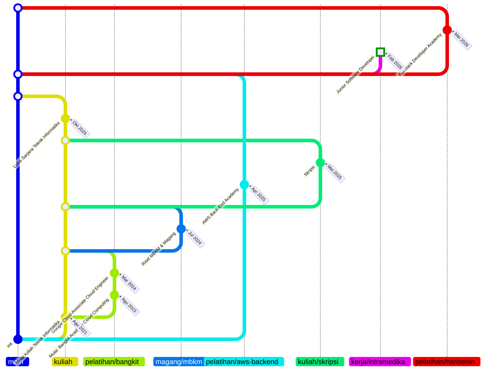

# 04 - Pages

Status: **Approved** (disetujui owner, 2026-10-31; revisi section 3 Experience, Q4.14 sampai Q4.21, disetujui 2026-10-31). Tautan kredensial sertifikat dan Q4.22 disetujui 2026-11-01. Pemandangan dan Contact di semua halaman (Q7.9 di `07-scenery.md`), aset brand (Q4.24), dan 404 tanpa berang-berang besar (Q4.26) disetujui 2026-11-01.

Spec ini menjabarkan konten dan layout tiap route dari `01-overview.md`. Tampilan visual mengikuti `02-design-system.md`, bahasa mengikuti `03-i18n.md`, dan cerita project mengikuti `06-project-stories.md`. Sumber data konten: CV owner (versi Indonesia dan Inggris) dan situs lama.

## Route

| Path | Halaman |
|---|---|
| `/` | Halaman utama: Hero, Tech stack, Experience, Works, Contact |
| `/projects/:slug` | Detail project |
| `/cv` | Halaman CV (pratinjau, unduh PDF, buka di tab baru) |
| `*` | 404 |

## Layout global

- **Skip link** "Lompat ke konten" sebagai elemen pertama yang bisa difokuskan (tampil saat difokus).
- **Navbar** (menempel di atas, tinggi 64px): logo `alvinreihans` (tautan ke `/`), tautan Pengalaman, Project, Kontak (sesuai urutan section), tautan **CV** (ke `/cv`), tombol tema (ikon), dan tombol bahasa (ikon bendera). Tautan CV di navbar memastikan CV bisa dibuka dari halaman mana pun (G2 di `01-overview.md`).
- **Konten utama** di dalam `<main id="content">`.
- **Langit, adegan, dan Contact** di setiap halaman: langit selebar halaman di belakang isi, lalu adegan acak dan section Contact di atas tekstur tanah, berakhir dengan baris copyright (`07-scenery.md`, Q7.9).

### Perilaku navbar

- Tautan navbar menuju section di halaman utama (`/#experience`, `/#works`, `/#contact`). Dari `/projects/:slug`, tautan itu membawa pengunjung ke `/` lalu menggulir ke section tujuan.
- Penggulungan ke section halus (`smooth`), kecuali `prefers-reduced-motion` aktif (langsung loncat). Section memakai `scroll-margin-top` agar tidak tertutup navbar.
- **Fokus tidak tertutup navbar** (WCAG 2.2 AA, Focus Not Obscured): `<html>` memakai `scroll-padding-top` setinggi navbar ditambah jarak, sehingga elemen yang difokus dengan keyboard tidak bersembunyi di balik navbar yang menempel, di semua halaman.
- **Tautan navbar di beranda (desktop, 640px ke atas):** selama deretan tombol hero masih terlihat di layar, tautan Pengalaman, Project, Kontak, dan CV di navbar **disembunyikan secara visual saja** (opacity 0, tidak bisa diklik mouse), tetapi tetap ada di pohon aksesibilitas sehingga dibacakan screen reader. Tautan langsung terlihat begitu fokus keyboard masuk ke salah satunya. Setelah deretan tombol hero tergulir keluar layar, tautan muncul dengan efek pudar (hanya opacity, sekitar 200ms masuk dan 140ms keluar); saat pengunjung menggulir kembali ke atas, tautan memudar lagi. Posisi deretan tombol dipantau dengan IntersectionObserver. Efek pudar mati saat `prefers-reduced-motion` aktif. Status akhir selalu benar walau pengunjung menggulir naik-turun dengan cepat.
- **Di halaman selain beranda**, tautan navbar selalu terlihat.
- **Mobile (di bawah 640px):** tautan disembunyikan dan diganti tombol menu, yang **selalu terlihat** di semua halaman dan semua posisi gulir (screen reader di HP menyorot elemen satu per satu, jadi tombol yang tersembunyi secara visual akan membingungkan). Menu terbuka sebagai panel di bawah navbar dengan `aria-expanded`, bisa ditutup dengan `Esc`, dengan mengetuk di luar panel, dan otomatis setelah memilih tautan; fokus kembali ke tombol menu saat ditutup lewat `Esc`. Tombol tema dan tombol bahasa tetap terlihat di navbar.
- Tidak ada penanda section aktif (scrollspy) pada versi pertama.

### Perilaku antar halaman (SPA)

- Berpindah route memindahkan fokus ke judul utama (`<h1>`) halaman baru dan memperbarui `document.title` (format: `<Halaman> · alvinreihans`).
- Berpindah ke halaman baru dimulai dari atas; tombol kembali browser memulihkan posisi gulir sebelumnya.

## Halaman utama `/`

Urutan section: Hero, Tech stack, Experience, Works, Contact.

### 1. Hero

- Heading Jersey 10 dua baris; baris kedua beraksen (`--accent-display`).
- Paragraf pembuka singkat bersumber dari ringkasan di CV, dengan peran **full-stack developer** (lihat Draf teks). Bagian ringkasan CV yang menyebut hal spesifik tentang pekerjaan di PT Intramedika Global Digital **tidak** dipakai.
- **Deretan tombol hero:** tombol utama **Lihat CV** (oranye, tautan internal ke `/cv`), lalu tombol sekunder **Pengalaman**, **Project**, dan **Kontak** (menggulir ke section-nya). Hanya ada satu tombol oranye. Di bawah 640px tombol tersusun 2×2, setiap tombol setinggi minimal 44px dengan jarak minimal 8px. Kontak menggantikan "Hubungi saya": section Kontak sudah menyediakan Kirim email dan Salin email.
- Tautan sosial berupa ikon: LinkedIn, GitHub, dan Instagram.
- Dekorasi langit di sisi kanan (matahari di Day, bulan di Night); awan dan bintang berada di lapisan langit selebar halaman (`07-scenery.md`). Tidak ada foto profil, tidak ada badge, dan tidak ada maskot di hero.

### 2. Tech stack

Lima kelompok, tanpa tingkat kemahiran (tidak ada bar atau persentase). Isinya mengikuti daftar "Technical skills" di CV:

| Kelompok | Isi |
|---|---|
| Bahasa & Frontend | JavaScript, TypeScript, React, Next.js, Tailwind CSS |
| Backend | Node.js, Express.js, Hapi, REST API, JWT Auth, RBAC, Clean Architecture, TDD, MQTT |
| Database & Storage | PostgreSQL, MySQL, Oracle Database, Redis, Supabase, MinIO |
| AI & OCR | OCR Tesseract, Integrasi LLM |
| Cloud & DevOps | AWS (EC2, RDS, S3, IAM), Google Cloud (Compute Engine, Cloud SQL), Vercel, GitHub Actions (CI/CD), Docker, Linux (Ubuntu), PM2, Nginx, Git |

Nama teknologi tidak diterjemahkan. Data disimpan sebagai konstanta di kode (`src/content/stack`), bukan di berkas terjemahan. Daftar ini mengikuti CV apa adanya (Flask dan Python tidak masuk karena tidak ada di CV).

### 3. Experience (roadmap bergaya graph GitHub)

> Direvisi dan disetujui 2026-10-31 (Q4.14 sampai Q4.21); tautan kredensial sertifikat dan Q4.22 disetujui 2026-11-01. Bagian ini menggambarkan keadaan terbaru; riwayat keputusannya ada di bagian **Keputusan**.

Section ini menampilkan perjalanan kuliah, kerja, dan belajar sebagai **graph commit vertikal**, seperti graph riwayat di GitHub atau VS Code: `main` dengan commit `init`, lalu cabang yang bercabang dan menyatu kembali.

**Aturan cabang**
- **`main`** hanya berisi commit **`init`** di baris paling bawah dan simpul merge. Tidak ada kartu kejadian di `main` (Q4.19).
- **Kuliah** (`kuliah`) dan **Pekerjaan** (`kerja/intramedika`) masing-masing cabang sendiri yang bercabang dari `main`.
- Cabang boleh punya **induk** (`parent`): ia bercabang dari induknya saat kegiatan dimulai dan menyatu kembali ke induk itu **pada tanggal selesainya**, sehingga cabang terlihat berjalan melewati kejadian lain di periode itu.
  - Induk `kuliah`: **Bangkit** (`pelatihan/bangkit`), **Riset MBKM & Magang** (`magang/mbkm`), dan **Skripsi** (`kuliah/skripsi`).
  - Induk `main`: **Kuliah**, **AWS Back-End Academy** (`pelatihan/aws-backend`, selesai setelah lulus sehingga tidak bisa menyatu ke `kuliah`), **Harisenin** (`pelatihan/harisenin`), dan **Pekerjaan**.
- Cabang yang masih berjalan (`ongoing`, yaitu pekerjaan saat ini) tidak punya merge.
- Sebuah cabang boleh berisi lebih dari satu commit, model **mulai lalu selesai** (Q4.17). Contohnya Bangkit: commit "Mulai" lalu commit sertifikasi Google ACE, baru merge.
- **Sertifikasi bukan cabang** (Q4.16). Sertifikat tampil di dalam kartu program asalnya; sertifikat yang paling penting boleh menjadi commit sendiri di cabang programnya (jenis `certification`, label saja).
- Urutan dari terbaru di atas ke terlama di bawah, seperti `git log`. Posisi mengikuti urutan kejadian, bukan skala waktu.

**Gambaran graph** (Mermaid sebagai gambaran saja; situs memakai SVG buatan sendiri yang mengikuti tema dan bahasa, dan urutan barisnya dihitung oleh algoritma di bawah). Kejadian tertua di bawah (`BT`):



Dengan data ini paling banyak **empat jalur** berjalan bersamaan (`main`, `kuliah`, AWS Back-End Academy, Skripsi), pada Mei sampai Okt 2025.

**Tampilan di situs**
- Setiap kejadian adalah satu "commit": simpul persegi pixel di jalurnya, dengan kartu di sampingnya berisi label jenis, judul, organisasi, periode, dan (jika ada) ringkasan.
- Simpul **merge** berupa persegi kecil berongga di jalur induknya, tanpa kartu.
- Commit **`init`** berupa persegi berongga di dasar `main` dengan chip teks `init`, tanpa kartu.
- **Ujung atas** `main` dan cabang yang masih berjalan naik sedikit di atas baris teratas dan diakhiri persegi penuh, seperti ujung cabang yang terbuka.
- Pekerjaan saat ini diberi chip **HEAD**, dan periodenya berakhir "Sekarang" / "Present".
- Kartu pertama tiap cabang memuat **chip label cabang**, mirip label branch di GitHub (misalnya ID `pelatihan/bangkit`, EN `training/bangkit`; teks label ada di data tiap bahasa).
- Warna tidak ditambah (tetap satu aksen). `main` dan Pekerjaan memakai `--accent` bergaris solid; cabang lain memakai warna netral (`--muted`, simpul `--ink`) dengan pola berbeda: Kuliah solid, Magang titik-titik, Pelatihan putus-putus, Skripsi putus-titik. Pembeda utamanya tetap label teks.
- Tidak ada legenda (Q4.21): label jenis dan chip label cabang di setiap kartu sudah menjelaskan setiap jalur.
- Kartu dapat memuat **tautan hasil** berupa chip yang dibuka di tab baru: repo GitHub, ORCID, atau halaman kredensial (Credly). Kartu program dapat memuat daftar **sertifikasi** (tiga sorotan, lalu tombol "Lihat N lainnya" yang mengembangkan sisanya dengan animasi; Q4.22); judul sertifikat menjadi tautan bila punya `href`.
- Kartu **Sertifikat lainnya** berisi sertifikat di luar program dan tautan "Lihat semua N sertifikat di LinkedIn". Mulai lebar 1024px kartu ini berada di kolom kanan di samping graph dan menempel (sticky) di bawah navbar saat digulir; di bawah 1024px kartu ini berada di bawah graph.
- Kartu memakai bayangan kartu dari `02-design-system.md`.
- Garis dan simpul adalah SVG dekoratif (`aria-hidden`), bergaya pixel (`crispEdges`). Chip `init` juga dekoratif.

**Aksesibilitas dan responsif**
- Strukturnya daftar berurutan (`<ol>`) berisi kejadian saja (tanpa merge dan `init`); tiap item membawa label teks jenisnya ("Kuliah", "Pekerjaan", "Magang", "Pelatihan", "Sertifikasi") dan tanggal dalam elemen `<time>`.
- "Lihat N lainnya" adalah `<button>` dengan `aria-expanded` dan `aria-controls`. Sisa sertifikat muncul di bawah sorotan tanpa mengulangnya; selama tertutup daftar itu `inert` (tautannya tidak terkena Tab). Daftar mengembang dengan transisi tinggi dan opacity sekitar 0,3 detik dan ikon panah pixel berputar; transisi mati saat `prefers-reduced-motion` aktif. Saat terbuka teks tombol menjadi "Sembunyikan". Semua tautan eksternal punya nama aksesibel yang menyebutkan bahwa tautan itu eksternal.
- Di mobile, jarak antarjalur menyempit (18px) dan kartu memenuhi sisa lebar; tanpa scroll horizontal di 320px.
- Tidak ada animasi garis; jika nanti ditambahkan, berhenti saat `prefers-reduced-motion` aktif.

**Algoritma penempatan jalur** (agar data baru tidak perlu mengatur posisi manual):
1. Setiap cabang menyatu pada tanggal selesainya: `end` terbesar (atau tanggal) di antara kejadiannya. Cabang `ongoing` tidak menyatu.
2. Kejadian dan baris merge diurutkan dari terbaru ke terlama. Pada **tanggal yang sama**, urutan dari atas mengikuti kedalaman cabang: merge sebuah cabang, lalu kejadian di cabang itu, lalu merge dan kejadian cabang anaknya. Akibatnya Skripsi menyatu ke `kuliah` sebelum Lulus, dan `kuliah` menyatu ke `main` setelah Lulus. Sisa seri diurutkan menurut urutan di berkas data.
3. Jalur 0 selalu `main`. Dari baris terbawah ke atas, setiap cabang menempati jalur bebas terkecil di kanan `main` sejak kejadian pertamanya sampai merge, dan jalur itu dipakai ulang setelahnya. Jalur induk dicatat saat cabang dibuka; induk yang tidak sedang terbuka jatuh ke `main`.
4. Baris `init` selalu yang terakhir.
5. Kartu ditempatkan di sebelah kanan jalur paling kanan yang aktif pada barisnya.

**Data** disimpan di `src/content/experience.json`:

```json
{
  "branches": [
    { "id": "bangkit", "kind": "training", "parent": "kuliah",
      "label": { "id": "pelatihan/bangkit", "en": "training/bangkit" } }
  ],
  "events": [
    { "date": "2024-03", "branch": "bangkit", "type": "certification",
      "org": "Google Cloud",
      "title": { "id": "Google Cloud Associate Cloud Engineer", "en": "Google Cloud Associate Cloud Engineer" },
      "links": [{ "kind": "credential", "href": "https://www.credly.com/badges/…", "label": "Credly" }] }
  ],
  "otherCertifications": [
    { "title": "SQL (Basic)", "issuer": "HackerRank", "date": "2024-03" }
  ]
}
```

- Cabang: `kind` bernilai `education`, `work`, `internship`, `training`, atau `thesis`; `parent` (opsional, bawaan `main`); `ongoing: true` untuk cabang yang masih berjalan.
- Kejadian: `branch` bernilai id cabang. `type` bernilai `education`, `work`, `internship`, `training`, atau `certification`.
- Tanggal ditulis `YYYY-MM` dan ditampilkan dengan format bulan-tahun (lihat `03-i18n.md`). `summary` boleh dikosongkan.
- `end` (opsional, `YYYY-MM`): kejadian berupa rentang waktu dalam **satu kartu**, misalnya "Mei 2026 – Agustus 2026" (Q4.14).
- `current: true` (opsional): kejadian yang masih berjalan (pekerjaan saat ini); kartu menampilkan "Februari 2026 – Sekarang" dan chip HEAD.
- `links` (opsional): daftar `{ "kind": "github" | "orcid" | "credential", "href", "label" }`.
- `certifications` (opsional): daftar `{ "title", "issuer", "date", "highlight"?, "href"? }`; tiga yang bertanda `highlight` selalu terlihat. Judul sertifikat ditulis persis seperti di penerbitnya (tidak diterjemahkan). Sertifikat di luar program disimpan di `otherCertifications`.

**Daftar kejadian** (timeline owner, 2026-10-31; terbaru dulu):

| Periode | Cabang (induk) | Jenis | Judul (Indonesia) | Hasil |
|---|---|---|---|---|
| Mei 2026 – Agu 2026 | `pelatihan/harisenin` (`main`) | Pelatihan | FullStack Developer Academy (bootcamp), Harisenin | repo `videobelajar-react` |
| Feb 2026 – sekarang | `kerja/intramedika` (`main`, masih berjalan) | Pekerjaan | Junior Software Developer, PT Intramedika Global Digital | – |
| Okt 2025 | `kuliah` (`main`) | Kuliah | Lulus Sarjana Teknik Informatika, Universitas Lampung | – |
| Mei 2025 – Okt 2025 (perkiraan owner) | `kuliah/skripsi` (`kuliah`) | Kuliah | Skripsi: backend pemantauan Smart Stick IoT real-time | repo `teman-jalan` |
| Apr 2025 – Des 2025 | `pelatihan/aws-backend` (`main`) | Pelatihan | AWS Back-End Academy (Dicoding × AWS) | repo `dicoding-garuda-games-chat-forum` |
| Jul 2024 – Agu 2024 | `magang/mbkm` (`kuliah`) | Magang | Riset MBKM & Magang, Gita Persada Butterfly Park | repo `ImageClassificationAPI-MBKMP`, ORCID |
| Mar 2024 | `pelatihan/bangkit` (`kuliah`) | Sertifikasi | Google Cloud Associate Cloud Engineer (berlaku sampai Mar 2027) | kredensial Credly |
| Agu 2023 – Jan 2024 | `pelatihan/bangkit` (`kuliah`) | Pelatihan | Mulai: Bangkit Academy Cloud Computing (Studi Independen MBKM bersama Google, GoTo, Traveloka) | repo `CropOptima-Fullteam` |
| Agu 2021 | `kuliah` (`main`) | Kuliah | Mulai kuliah Teknik Informatika, Universitas Lampung | – |

Catatan:
- **PT Intramedika Global Digital:** kartu hanya menampilkan organisasi, peran, dan periode, tanpa ringkasan. Owner menyatakan belum ada hal dari pekerjaan ini yang bisa dipublikasikan.
- **Riset MBKM & Magang** adalah satu kejadian di Gita Persada Butterfly Park (Q4.7). Di sini owner menerapkan ilmu dari Bangkit; hasil risetnya terbit di tiga publikasi (ORCID `0009-0005-6629-9783`).
- **Bangkit Academy** adalah program Studi Independen Bersertifikat (MSIB Kampus Merdeka) jalur Cloud Computing. Sebagian besar sertifikat owner berasal dari sini, termasuk Google Associate Cloud Engineer.
- **Tanggal** Bangkit, Harisenin, kuliah, dan Intramedika dari owner; MBKM dan AWS dari CV (cocok dengan riwayat commit repo hasilnya); Skripsi perkiraan owner.

**Sertifikasi** (Q4.16, Q4.17). Sumber: daftar Licenses & certifications di LinkedIn owner (43 sertifikat, 2026-10-31). Tautan kredensial diambil dari tombol "Show credential" di halaman LinkedIn owner yang disimpan (2026-11-01): 42 dari 43 sertifikat punya tautan langsung ke penerbit (pengalih LinkedIn dan parameter `utm_` dibuang). English Proficiency Test tidak punya halaman kredensial (hanya lampiran gambar di LinkedIn), jadi tanpa tautan.

| Kelompok | Jumlah | Sorotan / isi |
|---|---|---|
| Bangkit Academy (commit "Mulai") | 29 (24 skill badge Google Cloud Skills Boost, 3 kelas Dicoding, 2 Coursera) | Menjadi Google Cloud Engineer (Dicoding, Okt 2023); System Administration and IT Infrastructure Services (Coursera, Okt 2023); Essential Google Cloud Infrastructure: Core Services (Google Cloud Skills Boost, Okt 2023) |
| Bangkit Academy (commit sendiri) | 1 | Google Cloud Associate Cloud Engineer (Mar 2024, berlaku sampai Mar 2027) |
| AWS Back-End Academy | 6 (kelas Dicoding) | Menjadi Back-End Developer Expert dengan JavaScript (Des 2025); Architecting on AWS (Sep 2025); Belajar Fundamental Back-End dengan JavaScript (Agu 2025) |
| Sertifikat lainnya | 7 | HackerRank JavaScript, SQL, Python, React (Basic); EF SET English Certificate 72/100 (C2 Proficient); English Proficiency Test (Language Center Universitas Lampung); Responsive Web Design (freeCodeCamp) |

**Ringkasan kejadian** (dari CV tulisan owner; ditandai `_review` sampai ditinjau):

| Kejadian | Indonesia | Inggris |
|---|---|---|
| Lulus | Sarjana Teknik Informatika, IPK 3,88/4,00. | Bachelor of Engineering in Informatics Engineering, GPA 3.88/4.00. |
| Skripsi | Backend aplikasi pemantauan Smart Stick IoT real-time berbasis MQTT dan Node.js: data perangkat masuk tiap 5 detik lewat MQTT, disimpan ke database, dan status terkininya disimpan di Redis. | Backend for a real-time IoT Smart Stick monitoring app built on MQTT and Node.js: device data arrives every 5 seconds over MQTT, is stored in a database, and its latest state is kept in Redis. |
| Mulai: Bangkit Academy | Studi independen Kampus Merdeka selama satu semester di jalur Cloud Computing (Google Cloud). Proyek akhir CropOptima: layanan backend untuk aplikasi Android pertanian yang terhubung dengan model machine learning, di-deploy di Compute Engine dan Cloud SQL. | A one-semester Kampus Merdeka independent study on the Cloud Computing path (Google Cloud). Final project CropOptima: a backend service for an agriculture Android app connected to machine learning models, deployed on Compute Engine and Cloud SQL. |
| Google ACE | Sertifikasi profesional Google Cloud dari program Bangkit. Berlaku sampai Maret 2027. | Professional Google Cloud certification through the Bangkit program. Valid until March 2027. |
| Riset MBKM & Magang | Menerapkan ilmu dari Bangkit ke riset: RESTful API Flask untuk klasifikasi tanaman dengan model CNN, di-deploy di Google Compute Engine dengan Cloud SQL dan Cloud Storage. Hasil risetnya terbit di tiga publikasi. | Applied what I learned at Bangkit to research: a Flask RESTful API for plant classification with a CNN model, deployed on Google Compute Engine with Cloud SQL and Cloud Storage. The research was published in three papers. |
| AWS Back-End Academy | Membangun layanan backend forum obrolan gim dengan clean architecture dan TDD, pipeline CI/CD GitHub Actions, serta deployment ke Amazon EC2 dan Amazon RDS. | Built a backend service for a gaming chat forum using clean architecture and TDD, a GitHub Actions CI/CD pipeline, and deployment to Amazon EC2 and Amazon RDS. |
| Harisenin | Proyek akhir Video Belajar: platform kursus online berbentuk monorepo dengan SPA React (Vite, Tailwind CSS, Redux) dan REST API Express.js dengan MySQL. | Final project Video Belajar: an online course platform structured as a monorepo, with a React SPA (Vite, Tailwind CSS, Redux) and an Express.js and MySQL REST API. |

### 4. Works

- **Project hero (Money Tracker):** kartu besar di bagian atas section: judul, ringkasan, diagram arsitektur (komponen `flow`, lihat `06-project-stories.md`), tag, dan tautan. Karena tombol utama sudah dipakai di hero, tautan di sini berbentuk **tautan teks**: "Baca ceritanya" (ke `/projects/money-tracker`), "Lihat demo", dan "Lihat repo".
- **Kartu project lain:** grid (1 kolom di bawah 640px, 2 kolom di atasnya) untuk project sisanya. Setiap kartu menampilkan judul, ringkasan, dan tag.
- Isi dan urutan dibuat dari `meta.json` tiap project (urutan mengikuti `order`).
- **Satu tautan utama per kartu:** judul menuju `/projects/:slug`, dengan area klik yang menutupi seluruh kartu. Tautan repo dan demo adalah tautan terpisah di atasnya (tidak ada tautan di dalam tautan).
- Tautan eksternal dibuka di tab baru dengan `rel="noopener noreferrer"` dan diberi penanda ikon serta nama aksesibel yang menyebutkan bahwa tautan itu eksternal.

### 5. Contact

- Heading Jersey 10 dan satu kalimat yang menyatakan Alvin terbuka untuk peluang baru (G8 di `01-overview.md`), tanpa badge.
- Tombol **Kirim email** (`mailto:` dengan subjek sesuai bahasa) dan tombol **Salin email** (menyalin alamat; setelah berhasil teksnya berubah sebentar menjadi "Email disalin" dan diumumkan lewat `aria-live="polite"`).
- Tautan sosial (sama seperti di hero): LinkedIn, GitHub, Instagram.
- Tepat di atas section ini ada adegan pixel acak dengan berang-berang yang bisa disapa, dan section ini memakai tekstur tanah adegan sebagai latar (`07-scenery.md`).
- Tidak ada form. Nomor telepon tidak ditampilkan di situs.

### Footer

Satu baris: `© <tahun> alvinreihans` (tahun dihitung otomatis dari tanggal saat ini). Tidak ada tautan lain.

## Detail project `/projects/:slug`

Urutan dari atas ke bawah:

1. Tautan kembali "Semua project" ke `/#works`.
2. **Kotak fakta:** judul (`<h1>`, Jersey 10), ringkasan, tag, tautan repo dan demo (dari `meta.json`).
3. **Pemberitahuan bahasa** (hanya jika perlu): jika `en.md` belum ada saat bahasa Inggris dipilih, tampil di atas cerita: "This story isn't available in English yet. Showing the Indonesian version."
4. **Cerita** (markdown): satu kolom dengan lebar baca maksimal sekitar 70 karakter. Gambar mengikuti lebar kolom, diagram `flow` dirender di tempatnya.
5. **Project berikutnya:** tautan ke project berikutnya menurut `order` (project terakhir kembali ke yang pertama).
6. Adegan dan Contact (sama dengan beranda).

Slug yang tidak ada menampilkan halaman 404 yang sama.

## Halaman CV `/cv`

Referensi tampilan: `mockups/d-cv-page.html` (lokal). Urutan dari atas ke bawah:

1. Tautan kembali "Kembali ke beranda" ke `/`.
2. Badge kecil "Selalu versi terbaru".
3. Judul (`<h1>`, Jersey 10): "CV" beraksen diikuti nama.
4. Satu kalimat: pratinjau diambil langsung dari dokumen CV, jadi selalu versi terbaru.
5. Tombol utama **Unduh PDF** (tautan ekspor) dan tombol sekunder **Buka di tab baru** (tautan pratinjau). Keduanya ke dokumen sesuai bahasa aktif, membuka tab baru. Di bawah 640px kedua tombol selebar layar.
6. **Bingkai pratinjau:** kartu berisi `<iframe>` ke tautan pratinjau Google Docs (lihat `03-i18n.md`), tinggi sekitar 80% layar (70% di mobile), dengan `title` deskriptif sesuai bahasa, `loading="lazy"`, dan teks "Memuat pratinjau…" sampai iframe selesai dimuat.
7. Petunjuk kecil: jika pratinjau terlalu kecil di HP, gunakan "Buka di tab baru" atau unduh PDF.
8. Adegan dan Contact (sama dengan beranda).

Perilaku dan batasan:
- Isi bingkai adalah tampilan pratinjau milik Google (latar dan kontrol kecil Google), tidak mengikuti tema Day/Night. Yang mengikuti tema adalah halaman di sekelilingnya.
- Jika iframe gagal dimuat (misalnya pengaturan berbagi dokumen berubah), tombol Unduh PDF dan Buka di tab baru tetap tersedia sebagai jalan keluar.
- `document.title`: "CV · alvinreihans".
- `alvinreihans.web.id/cv` adalah tautan pendek resmi untuk CV (misalnya di email lamaran dan profil LinkedIn).

## 404

- Tidak ada berang-berang besar (Q4.26). Berang-berang di adegan di bawah halaman sudah menemani, dan tetap bisa disapa.
- Heading "404" (Jersey 10), pesan singkat, dan tombol utama **Kembali ke beranda**.
- Muncul untuk path yang tidak dikenal dan slug project yang tidak ada, di dalam layout global (navbar, langit, adegan, dan Contact tetap tampil).

## Responsif

Mobile first. Titik patah: 640px, 768px, 1024px. Lebar konten maksimum 1200px dengan gutter minimal 24px. Semua halaman diuji di 320px, 390px, 768px, dan 1280px, pada kedua bahasa dan kedua tema.

## CV publik

CV yang bisa diunduh dari situs adalah dokumen Google Docs yang dapat dibuka siapa saja yang punya tautannya, jadi isinya harus aman dipublikasikan:

- **Tanpa nomor telepon** (keputusan owner). Kontak di CV memakai email, LinkedIn, dan alamat situs.
- **Rincian pekerjaan di PT Intramedika Global Digital diringkas** (keputusan owner): tanpa angka spesifik (jumlah kode izin, endpoint, atau berkas), tanpa nama sistem atau lembaga eksternal yang terhubung, dan tanpa nama produk internal.
- Ringkasan profil di CV disamakan dengan teks hero: tidak menyebut klaim BPJS atau sistem pemerintah.
- CV kerja owner yang sekarang (berisi nomor telepon dan rincian pekerjaan) **belum memenuhi aturan di atas**, jadi tidak boleh dipakai sebagai CV publik. Owner membuat **salinan khusus publik** (Indonesia dan Inggris) di Google Docs, menerapkan aturan di atas pada salinan itu, dan hanya salinan itu yang ditautkan dari situs.

### CV lewat Google Docs (keputusan Q5.2)

- Halaman `/cv` menampilkan pratinjau dokumen publik di iframe dan menyediakan tautan ekspor PDF (lihat `03-i18n.md`), sehingga setiap pembaruan di dokumen otomatis ikut terbaru tanpa deploy ulang. Penanaman pratinjau di iframe sudah diuji bekerja dengan dokumen owner pada 2026-10-31.
- Pengaturan dokumen: berbagi "Siapa saja yang memiliki tautan: Pelihat", dengan unduh, cetak, dan salin diizinkan (kalau tidak, tautan ekspor tidak berfungsi untuk pengunjung).
- Karena dokumen bisa dilihat langsung, **setiap suntingan langsung terlihat publik**, termasuk suntingan yang belum selesai. Suntingan pada salinan publik dilakukan dengan hati-hati; CV kerja yang berisi data pribadi tidak pernah dijadikan publik.
- Judul dokumen menjadi nama berkas yang terunduh, jadi diberi nama yang rapi, misalnya "CV - Alvin Reihansyah Makarim (Indonesia)" dan "CV - Alvin Reihansyah Makarim (English)".
- Aturan di atas tidak bisa dipaksakan saat build, jadi dijaga lewat pemeriksaan: skrip kecil mengambil kedua tautan ekspor, mengekstrak teksnya, dan memeriksa pola nomor telepon serta kata kunci terlarang. Dijalankan sebelum cutover dan atas permintaan owner setelahnya.

Usulan ringkasan bullet untuk bagian PT Intramedika Global Digital (dipakai di kedua versi CV):

| Indonesia | Inggris |
|---|---|
| Mengembangkan fitur backend dan integrasi dengan sistem eksternal pada aplikasi SaaS multi-tenant untuk pengelolaan klaim di lingkungan rumah sakit. | Developed backend features and integrations with external systems for a multi-tenant SaaS application for claims management in hospitals. |
| Merancang ulang kontrol akses menjadi berbasis izin dan menegakkannya secara terpusat di seluruh endpoint API. | Redesigned access control into a permission-based model and enforced it centrally across all API endpoints. |
| Membangun pipeline pemrosesan dokumen berbasis OCR dan LLM. | Built a document processing pipeline based on OCR and LLMs. |
| Menyiapkan CI/CD GitHub Actions, migrasi skema basis data, dan test suite berlapis. | Set up GitHub Actions CI/CD, database schema migrations, and a layered test suite. |

Usulan kalimat ringkasan profil di CV (Indonesia): "Sarjana Teknik Informatika Universitas Lampung yang kini bekerja sebagai full-stack developer, membangun aplikasi SaaS multi-tenant untuk pengelolaan klaim di lingkungan rumah sakit, mencakup kontrol akses berbasis izin dan pemrosesan dokumen berbasis OCR & LLM. Tertarik pada perancangan sistem backend yang andal, teruji, dan mudah diaudit." Versi Inggrisnya mengikuti.

Kata kunci terlarang yang diperiksa: `E-Klaim`, `INA-CBG`, `iDRG`, `SIMRS`, `BPJS`, ditambah pola nomor telepon.

## Metadata, favicon, dan gambar Open Graph

Metadata statis di `index.html`, dalam **bahasa Inggris** (keputusan Q3.7 di `03-i18n.md`), karena pratinjau tautan dan mesin pencari tidak menjalankan pemilihan bahasa:

- `<title>`, `<meta name="description">`, `<link rel="canonical" href="https://alvinreihans.web.id/">`.
- Open Graph: `og:type` (`website`), `og:title`, `og:description`, `og:url`, `og:image`, `og:image:alt`, `og:locale` (`en_US`) dan `og:locale:alternate` (`id_ID`).
- `<html lang="en">` sebagai nilai awal; skrip penentu bahasa menggantinya sebelum render pertama.
- Usulan teks (ditinjau owner): judul "Alvin Reihansyah Makarim · Full-Stack Developer"; deskripsi "Full-stack developer focused on reliable backend systems. Works with Node.js, React, and PostgreSQL, with production deployment experience on AWS and Google Cloud." Kartu Twitter/X: `twitter:card` = `summary_large_image`.

**Gambar Open Graph** (dibuat sebagai bagian dari pekerjaan ini):
- Berkas `public/og-image.png`, ukuran 1200x630, berat di bawah 300 KB.
- Isi: nama, peran (Full-Stack Developer), domain `alvinreihans.web.id`, maskot berang-berang, serta matahari dan awan pixel, dengan palet Day dan font Jersey 10 dan Manrope.
- Dihasilkan dari templat HTML sekali jalan (tangkapan layar), lalu berkasnya yang disimpan. Pembuatan menunggu sprite berang-berang disetujui (lihat `02-design-system.md`).
- Catatan: pratinjau tautan di LinkedIn dan platform lain menyimpan cache; perubahan gambar bisa baru terlihat setelah cache diperbarui.

**Favicon:** kepala berang-berang pixel (baris kepala dari sprite yang sama, dibingkai di grid 16x16), dalam `public/favicon.svg` ditambah `favicon-32.png` dan `apple-touch-icon.png` (180x180, berlatar `--bg` Day karena iOS mengisi bagian transparan dengan hitam).

**Pembuatan:** `npm run brand` (`scripts/generate-brand.mjs`) membuat favicon dan gambar Open Graph dari sprite di `src/components/beaver.ts` memakai Playwright (sudah menjadi devDependency), lalu hasilnya di-commit ke `public/`. Sprite yang sama dipakai adegan, favicon, dan gambar Open Graph, jadi semua tampilan berang-berang selalu sama (Q4.24).

`robots.txt` dan `sitemap.xml` (berisi `/` dan URL project) dibahas di `05-deployment.md`.

## Draf teks (perlu ditinjau owner)

Teks Indonesia adalah sumber. Semua entri di bawah ditandai `_review` sampai owner menyetujuinya (aturan 11 di `CLAUDE.md`). Hero lead bersumber dari ringkasan di CV owner, **tanpa** bagian yang menyebut pekerjaan di PT Intramedika Global Digital.

| Kunci | Indonesia | Inggris |
|---|---|---|
| `common:nav.experience` | Pengalaman | Experience |
| `common:nav.projects` | Project | Projects |
| `common:nav.contact` | Kontak | Contact |
| `common:nav.cv` | CV | CV |
| `common:skipToContent` | Lompat ke konten | Skip to content |
| `common:externalLink` | (tautan eksternal) | (external link) |
| `home:hero.titleLine1` | Membangun sistem backend | Building backend systems |
| `home:hero.titleLine2` | yang andal. | that stay reliable. |
| `home:hero.lead` | Saya Alvin, full-stack developer lulusan Teknik Informatika Universitas Lampung. Saya tertarik pada perancangan sistem backend yang andal, teruji, dan mudah diaudit, dengan Node.js, TypeScript, React, Express.js, dan PostgreSQL, serta pengalaman men-deploy ke produksi di AWS dan Google Cloud melalui CI/CD terotomatisasi. | I'm Alvin, a full-stack developer with a degree in Informatics Engineering from the University of Lampung. I'm interested in designing backend systems that are reliable, well-tested, and auditable, working with Node.js, TypeScript, React, Express.js, and PostgreSQL, and I have deployed to production on AWS and Google Cloud through automated CI/CD. |
| `home:hero.cv` | Lihat CV | View CV |
| `home:hero.actions` | Navigasi cepat | Quick links |
| `home:experience.heading` | Pengalaman | Experience |
| `home:experience.type.education` | Kuliah | Education |
| `home:experience.type.work` | Pekerjaan | Work |
| `home:experience.type.internship` | Magang | Internship |
| `home:experience.type.training` | Pelatihan | Training |
| `home:experience.type.certification` | Sertifikasi | Certification |
| `home:experience.present` | Sekarang | Present |
| `home:experience.legend.main` | main | main |
| `home:experience.legend.education` | Kuliah | Education |
| `home:experience.legend.work` | Pekerjaan | Work |
| `home:experience.legend.internship` | Magang | Internship |
| `home:experience.legend.training` | Pelatihan | Training |
| `home:experience.legend.thesis` | Skripsi | Thesis |
| `home:experience.certifications` | Sertifikasi | Certifications |
| `home:experience.showMore` | Lihat {{count}} lainnya | Show {{count}} more |
| `home:experience.showLess` | Sembunyikan | Show less |
| `home:experience.otherCertifications` | Sertifikat lainnya | Other certificates |
| `home:experience.allOnLinkedIn` | Lihat semua {{count}} sertifikat di LinkedIn | See all {{count}} certificates on LinkedIn |
| `home:works.heading` | Project | Projects |
| `home:contact.heading` | Mari berdiskusi. | Let's talk. |
| `home:contact.body` | Saya terbuka untuk peluang baru. Untuk pekerjaan, kolaborasi, atau sekadar menyapa, silakan kirim email. | I'm open to new opportunities. For a job, a collaboration, or just to say hello, feel free to send an email. |
| `home:contact.email` | Kirim email | Send email |
| `home:contact.copy` | Salin email | Copy email |
| `home:contact.copied` | Email disalin | Email copied |
| `project:back` | Semua project | All projects |
| `project:next` | Project berikutnya | Next project |
| `project:readStory` | Baca ceritanya | Read the story |
| `project:viewDemo` | Lihat demo | View demo |
| `project:viewRepo` | Lihat repo | View repo |
| `project:noEnglish` | (tidak dipakai) | This story isn't available in English yet. Showing the Indonesian version. |
| `cv:back` | Kembali ke beranda | Back to home |
| `cv:badge` | Selalu versi terbaru | Always up to date |
| `cv:intro` | Full-stack developer. Pratinjau di bawah diambil langsung dari dokumen CV saya, jadi selalu versi terbaru. | Full-stack developer. The preview below comes straight from my CV document, so it is always the latest version. |
| `cv:download` | Unduh PDF | Download PDF |
| `cv:openNewTab` | Buka di tab baru | Open in new tab |
| `cv:loading` | Memuat pratinjau… | Loading preview… |
| `cv:hint` | Pratinjau terlalu kecil di HP? Gunakan "Buka di tab baru" atau unduh PDF-nya. | Preview too small on your phone? Use "Open in new tab" or download the PDF. |
| `cv:frameTitle` | Pratinjau CV Alvin Reihansyah Makarim (bahasa Indonesia) | CV preview of Alvin Reihansyah Makarim (English) |
| `notFound:title` | Halaman tidak ditemukan | Page not found |
| `notFound:body` | Halaman yang Anda cari tidak ada atau sudah dipindahkan. | The page you're looking for doesn't exist or has moved. |
| `notFound:home` | Kembali ke beranda | Back to home |

Catatan: `project:noEnglish` hanya muncul saat bahasa Inggris dipilih dan `en.md` belum ada, jadi teks Indonesianya tidak dipakai. Kunci ini dikecualikan dari aturan keseimbangan kunci di `check-i18n`.

## Kriteria penerimaan

- [ ] AC1. Halaman utama menampilkan section Hero, Tech stack, Experience, Works, dan Contact sesuai urutan, pada kedua bahasa dan kedua tema.
- [ ] AC2. Tautan navbar menggulir ke section yang benar tanpa tertutup navbar, termasuk ketika diklik dari halaman detail project.
- [ ] AC3. Di bawah 640px, tautan navbar diganti tombol menu yang bisa dioperasikan keyboard (`Enter`, `Spasi`, `Esc`), memakai `aria-expanded`, dan mengembalikan fokus saat ditutup.
- [ ] AC4. Skip link berfungsi dan tampil saat difokus.
- [ ] AC5. Berpindah route memindahkan fokus ke `<h1>` dan memperbarui `document.title`.
- [ ] AC6. Section Works menampilkan semua project dari `meta.json`: Money Tracker sebagai kartu besar, sisanya sebagai kartu biasa, urut sesuai `order`.
- [ ] AC7. Setiap kartu hanya punya satu tautan utama ke halaman detail; tidak ada tautan bersarang; tautan eksternal membuka tab baru dengan `rel="noopener noreferrer"`.
- [ ] AC8. Halaman detail menampilkan tautan kembali, kotak fakta, cerita, dan tautan project berikutnya; slug tak dikenal menampilkan 404.
- [ ] AC9. Tombol "Salin email" menyalin alamat yang benar dan memberi umpan balik yang dibacakan screen reader.
- [ ] AC10. Footer menampilkan tahun berjalan otomatis.
- [ ] AC11. Halaman 404 menampilkan pesan, tombol kembali ke beranda, serta langit, adegan, dan Contact seperti halaman lain, dan muncul untuk path yang tidak dikenal.
- [ ] AC12. Hero tidak memuat foto profil, badge, atau maskot.
- [ ] AC13. Tidak ada scroll horizontal di 320px dan seterusnya, pada kedua bahasa dan kedua tema.
- [ ] AC14. `index.html` memuat canonical `https://alvinreihans.web.id/`, metadata dasar berbahasa Inggris, dan tag Open Graph lengkap (`og:locale` `en_US`) dengan `og:image` yang mengarah ke berkas yang ada.
- [ ] AC15. Roadmap menampilkan semua kejadian dari `experience.json`, urut dari terbaru, dan setiap item punya label teks jenis serta tanggal dalam `<time>`.
- [ ] AC16. `main` hanya memuat commit `init` dan simpul merge; Kuliah dan Pekerjaan punya cabang sendiri; Magang, Pelatihan, dan Skripsi bercabang dari induknya (`kuliah` atau `main`) saat mulai dan menyatu ke induk itu pada tanggal selesai; cabang `ongoing` (pekerjaan saat ini) tidak menyatu (Q4.19). Sertifikasi tidak punya garis sendiri dan tampil di kartu program asalnya, dengan "Lihat semua (N)" yang bisa dibuka dengan keyboard.
- [ ] AC17. Garis dan simpul roadmap tidak dibacakan screen reader (`aria-hidden`) dan pembedaan jenis tetap terbaca tanpa warna.
- [ ] AC18. Roadmap tetap terbaca (tanpa teks terpotong atau scroll horizontal) di 320px pada kedua bahasa dan kedua tema, dengan jalur yang tidak saling menimpa.
- [ ] AC19. Kartu PT Intramedika Global Digital hanya memuat organisasi, peran, dan periode.
- [ ] AC20. Tidak ada nomor telepon di halaman situs mana pun maupun di teks kedua CV publik (hasil ekstraksi tautan ekspor).
- [ ] AC21. Teks kedua CV publik tidak memuat kata kunci terlarang (`E-Klaim`, `INA-CBG`, `iDRG`, `SIMRS`, `BPJS`) dan rincian Intramedika sesuai versi ringkas.
- [ ] AC22. Tombol "Lihat CV" di hero dan tautan CV di navbar membuka halaman `/cv`; di sana tautan unduh kedua bahasa menjawab 200 bertipe PDF.- [ ] AC23. `public/og-image.png` berukuran 1200x630 dan di bawah 300 KB; favicon (`favicon.svg`, `favicon-32.png`, `apple-touch-icon.png`) tersedia.
- [ ] AC24. Halaman `/cv` menampilkan iframe pratinjau dari `docs.google.com` sesuai bahasa aktif, dengan `title` yang sesuai bahasa; teks "Memuat pratinjau…" hilang setelah iframe dimuat; tidak ada scroll horizontal di 320px.
- [ ] AC25. Hero menampilkan deretan tombol Lihat CV (satu-satunya tombol oranye), Pengalaman, Project, dan Kontak; di bawah 640px tersusun 2×2 dengan tinggi minimal 44px dan jarak minimal 8px.
- [ ] AC26. Di beranda pada lebar 640px ke atas: saat deretan tombol hero terlihat, tautan navbar tidak terlihat dan tidak bisa diklik mouse, tetapi tetap ada di pohon aksesibilitas dan langsung terlihat saat difokus keyboard; setelah deretan tombol hero tergulir keluar, tautan navbar terlihat dan bisa diklik; saat digulir kembali ke atas, tautan memudar lagi.
- [ ] AC27. Di halaman selain beranda, tautan navbar selalu terlihat; di bawah 640px tombol menu selalu terlihat di semua halaman dan posisi gulir.
- [ ] AC28. Mengetuk atau mengklik di luar panel menu mobile menutupnya.
- [ ] AC29. Elemen yang difokus dengan keyboard tidak pernah tertutup navbar yang menempel (`scroll-padding-top`).
- [ ] AC30. Efek pudar tautan navbar mati saat `prefers-reduced-motion` aktif.
- [ ] AC31. Ke-43 sertifikat tampil: tiga sorotan per kartu program, sisanya lewat tombol "Lihat N lainnya" yang bisa dibuka dan ditutup dengan keyboard (tanpa mengulang sorotan), dan tujuh sertifikat lain di kartu "Sertifikat lainnya" dengan tautan ke LinkedIn yang menyebut jumlah 43. Kartu itu berada di kolom kanan mulai 1024px dan di bawah graph di bawah 1024px.
- [ ] AC32. Graph memiliki commit `init` di dasar `main`, dan ujung atas `main` serta cabang yang masih berjalan diakhiri persegi; tautan hasil (GitHub, ORCID, Credly) dibuka di tab baru dengan nama aksesibel yang menyebut tautan eksternal.

## Keputusan

- Q4.1. Urutan section: Hero, Tech stack, Experience, Works, Contact (Experience dinaikkan di atas Works).
- Q4.2. Tidak ada ringkasan pekerjaan dari PT Intramedika Global Digital untuk saat ini. Pembelajaran ikut di Experience, dibedakan dari pekerjaan.
- Q4.3. Tautan sosial: LinkedIn, GitHub, dan Instagram.
- Q4.4. Teks hero memakai ringkasan CV (tanpa bagian tentang pekerjaan di PT Intramedika Global Digital); tetap ditinjau owner lewat penanda `_review`.
- Q4.5. Favicon kepala berang-berang pixel; gambar Open Graph dibuat sekarang (bagian dari pekerjaan ini).
- Q4.6. Tautan "Project berikutnya" dipakai di halaman detail.
- Q4.7. MBKM penelitian sama dengan magang di Gita Persada Butterfly Park (satu kejadian, di cabang magang).
- Q4.8. Pendidikan dan sertifikasi ikut di roadmap. Bentuk roadmap mengikuti graph GitHub: jalur utama berisi Kuliah dan Pekerjaan; cabang berisi Magang MBKM, Pelatihan, dan Sertifikasi.
- Q4.9. Tech stack mengikuti CV.
- Q4.10. Hero memakai "full-stack developer".
- Q4.11. Nomor telepon dihapus dari CV publik; rincian PT Intramedika Global Digital diringkas.
- Q4.12. CV ditampilkan di halaman sendiri `/cv` (pratinjau Google Docs di iframe, ditambah unduh PDF dan buka di tab baru), bukan langsung terunduh. Tombol hero menjadi "Lihat CV", dan navbar mendapat tautan CV.
- Q4.13. Di beranda, tautan navigasi tampil dulu sebagai deretan tombol di hero (Lihat CV, Pengalaman, Project, Kontak) dan baru muncul di navbar desktop setelah deretan itu tergulir lewat; tautan navbar disembunyikan secara visual saja agar tetap terbaca screen reader. Tombol menu mobile selalu terlihat dan bisa ditutup dengan mengetuk di luar panel. `scroll-padding-top` dipasang untuk WCAG 2.2 Focus Not Obscured. Rekomendasi ini ditinjau dengan skill ui-ux-pro-max (2026-10-31); panduan "Focus Not Obscured", "Sticky Navigation", dan pola landing "Hero + Features + CTA" terverifikasi di basis datanya, sedangkan detail pola "muncul setelah digulir" dan menu mobile adalah panduan umum karena tidak ada entri yang cocok.
- Q4.14. Tabel "Daftar kejadian" (14 kejadian) yang berlaku, bukan jumlah commit di diagram Mermaid. Kejadian berentang (Harisenin, MBKM) memakai kolom opsional `end` dalam satu kartu, dan pekerjaan saat ini memakai `current: true` untuk penanda HEAD. Diputuskan saat implementasi (2026-10-31) untuk menyelaraskan tabel dengan Q4.7; dikonfirmasi owner bersama revisi section 3.
- Q4.15. Experience dikerjakan dalam dua tahap di branch `feat/experience`: (1) data, algoritma penempatan jalur, dan daftar kartu yang aksesibel; (2) graph SVG, label cabang, legenda, dan penanda HEAD.
- Q4.16. Timeline diganti mengikuti timeline owner (2026-10-31): 8 kejadian, dengan Skripsi di jalur utama, Bangkit, Riset MBKM & Magang, AWS Back-End Academy, dan Harisenin sebagai cabang satu kartu, serta tautan hasil (repo, ORCID). Sertifikasi tidak lagi menjadi cabang (permintaan owner: "certification jangan disambung linenya"); 43 sertifikat dari LinkedIn ditampilkan di kartu program asalnya dengan tiga sorotan dan "Lihat semua", sisanya di kartu "Sertifikat lainnya" dengan tautan ke LinkedIn. Owner memilih tetap memakai graph bergaya GitHub, bukan garis lurus sederhana (`mockups/h-experience.html` ditolak).
- Q4.17. Owner meninjau roadmap satu per satu (2026-10-31) dan memilih model **mulai lalu selesai**: sebuah cabang boleh berisi lebih dari satu commit. Untuk Bangkit: commit "Mulai: Bangkit Academy Cloud Computing" (Agu 2023, kartu menampilkan periode program Agu 2023 – Jan 2024, penjelasan program, dan daftar sertifikatnya), lalu commit "Google Cloud Associate Cloud Engineer" (Mar 2024) dengan tautan kredensial Credly, lalu merge ke main. Sertifikat yang dijadikan commit sendiri memakai jenis `certification` (label saja, bukan jalur). Setiap sertifikat boleh punya tautan kredensial (`href`); tautan sertifikat lain menyusul dari daftar LinkedIn owner. Kejadian lain menunggu tinjauan berikutnya.
- Q4.18. Skripsi (Mei – Okt 2025, perkiraan owner) adalah cabang sendiri, bukan bagian jalur utama, berjalan sejajar dengan AWS Back-End Academy (Apr – Des 2025) karena keduanya selesai hampir bersamaan (owner, 2026-10-31). Graph memakai tiga jalur pada periode itu.
- Q4.19. Kuliah dan pekerjaan masing-masing jadi cabang sendiri (owner, 2026-10-31), supaya graph punya commit `init` dan commit merge seperti riwayat git. Ini menggantikan aturan "jalur utama berisi Kuliah dan Pekerjaan":
  - `main` hanya berisi commit `init` di baris paling bawah (simpul kecil berlabel `init`, dekoratif, tanpa kartu dan tidak masuk daftar) dan simpul merge.
  - Cabang `kuliah` (Agu 2021 – Okt 2025) berisi Mulai kuliah dan Lulus, lalu merge ke `main`.
  - Cabang boleh punya induk (`parent`). Bangkit, Riset MBKM & Magang, dan Skripsi bercabang dari `kuliah` dan merge kembali ke `kuliah`. AWS Back-End Academy dan Harisenin bercabang dari `main` (AWS selesai setelah lulus).
  - Cabang `kerja/intramedika` (Feb 2026 – sekarang) bercabang dari `main`, masih berjalan (`ongoing`), jadi tidak punya merge dan memakai penanda HEAD.
  - Pada tanggal yang sama, urutan dari atas mengikuti kedalaman cabang: merge sebuah cabang, kejadian di cabang itu, lalu merge dan kejadian cabang anaknya. Jadi Skripsi merge ke `kuliah` sebelum Lulus, dan `kuliah` merge ke `main` setelah Lulus.
  - Gaya garis: `main` oranye solid; Kuliah netral solid; Pekerjaan oranye solid tipis; Magang titik-titik; Pelatihan putus-putus; Skripsi putus-titik. Legenda memuat main, Kuliah, Pekerjaan, Magang, Pelatihan, dan Skripsi.
- Q4.20. Penyempurnaan tampilan setelah tinjauan owner (2026-10-31): ujung atas `main` dan cabang yang masih berjalan naik sedikit dan diakhiri persegi; kartu "Sertifikat lainnya" mengisi kolom kanan yang kosong mulai 1024px (sticky), bukan di bawah graph; semua kartu memakai bayangan kartu dari `02-design-system.md`. Bagian Experience ditulis ulang menjadi satu versi terbaru agar tidak bertentangan dengan keputusan Q4.14 sampai Q4.19.
- Q4.21. Legenda di atas graph dihapus (owner, 2026-10-31): label jenis dan chip label cabang di kartu sudah membedakan jalur, legendanya tersembunyi dari screen reader sehingga tidak membawa informasi, dan tanpa legenda kartu terbaru tampil lebih cepat.
- Q4.22. "Lihat semua (N)" diganti tombol "Lihat N lainnya" / "Sembunyikan" yang mengembangkan sisa sertifikat dengan animasi dan ikon panah, tanpa mengulang sorotan (owner: tombol lama terasa kaku, 2026-11-01).
- Q4.23. Tinjauan kartu satu per satu selesai (owner, 2026-11-01). Mulai kuliah, Bangkit, Riset MBKM & Magang, Skripsi, AWS Back-End Academy, Lulus, dan Intramedika sesuai bentuk sekarang; Harisenin tetap satu kartu (Mei – Agu 2026), tidak dipecah menjadi mulai lalu selesai.
- Q4.24. Maskot 404, favicon, dan gambar Open Graph dikerjakan dalam satu branch (owner, 2026-11-01), semuanya dari satu sprite di `src/components/beaver.ts`. 404 memakai pose Day duduk berkedip dan Night tidur dengan "z" melayang; favicon dan gambar Open Graph dibuat ulang dengan `npm run brand`. Bagian 404-nya dibatalkan oleh Q4.26.
- Q4.25. Berang-berang di 404 memakai versi detail 40x34 supaya terlihat lebih halus di ukuran besar (owner, 2026-11-01). Versi ini dihitung dari sprite 20x17 (`beaverDetailRows` di `src/components/beaver.ts`), jadi bentuknya tetap sama dengan yang di adegan; adegan dan favicon tetap memakai 20x17. **Dibatalkan oleh Q4.26.**
- Q4.26. Berang-berang besar di 404 dihapus (owner, 2026-11-01): sejak adegan tampil di semua halaman (Q7.9), dua berang-berang di satu layar terasa aneh. 404 cukup berisi pesan dan tombol kembali, dengan berang-berang di adegan di bawahnya. Komponen dan versi detail 40x34 ikut dihapus.
- Maskot diganti dari kucing menjadi **berang-berang** (lihat `01-overview.md` dan `02-design-system.md`).

## Pertanyaan terbuka

Tidak ada. Spec ini siap ditinjau untuk ditandai **Approved**. Tugas yang menyertainya, bukan keputusan desain: owner membuat dua salinan CV publik di Google Docs sesuai bagian "CV publik" dan memberikan ID dokumennya, dan menyetujui sprite berang-berang sebelum favicon dan gambar Open Graph dibuat.
